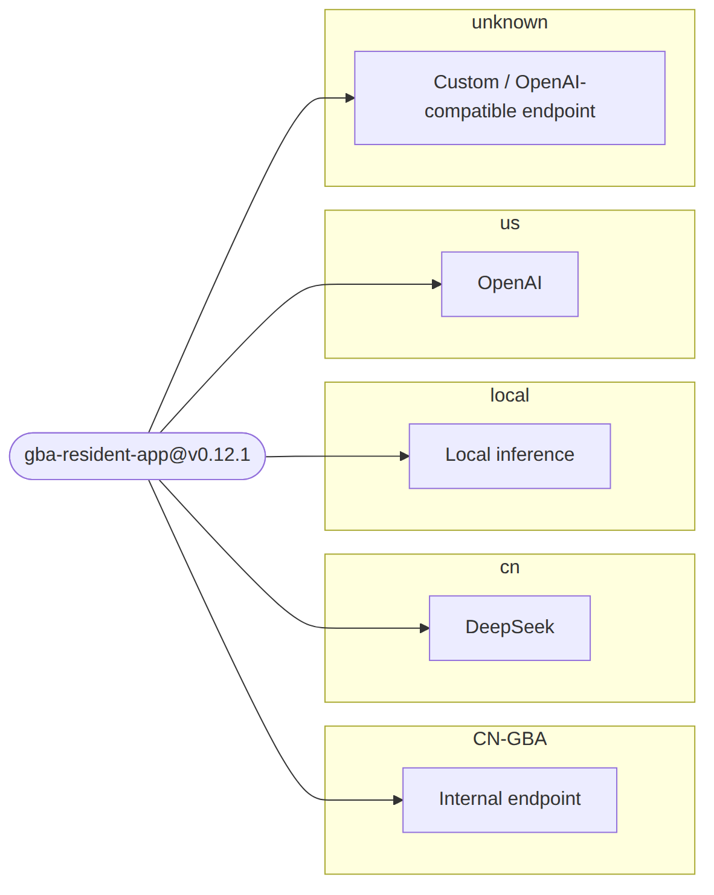

# borderlint

[](https://pypi.org/project/borderlint/)
[](https://github.com/marketplace/actions/borderlint-ai-data-residency-lint)

**Map where your AI data goes, check who can compel its disclosure, and identify whose model weights you use.**

borderlint scans code without running it. It checks three separate facts about each AI data flow:

- **Residency:** where the data goes.
- **Sovereignty:** which government's laws may compel the provider to disclose the data.
- **Provenance:** who developed the model weights.

It supports Python, TypeScript/JavaScript, Java/Kotlin, C#, configuration files, and Model Context
Protocol (MCP) server configurations. It has no runtime dependencies. Its strongest support is for
Hong Kong and the Greater Bay Area (GBA), with additional home locations across APAC and EMEA.
Western and Chinese providers receive the same checks.

## Quick start

Install borderlint, list the AI data flows in your repository, create a policy, then check your code
against that policy:

```bash
pip install borderlint

borderlint scan .        # List flows and jurisdictions; no policy needed.
borderlint init .        # Answer a short interview to create residency.json.
borderlint scan . --policy residency.json --classification customer-pii
```

A policy violation looks like this. Add `--explain` to include the arrow lines:

```text
borderlint — AI data-flow & residency report
==============================================
[FAIL] DeepSeek -> Mainland China | sovereignty: Mainland China | weights: Mainland China
        app.py:2 (endpoint_reference: api.deepseek.com)
           ! jurisdiction outside the allow-list for this data class
             → DeepSeek resolves to Mainland China, which is not allowed for this data class.
               Update the policy allow-list or change the provider/endpoint.

Regimes implicated: PIPL
Reference: PIPL cross-border transfer — Mainland China cross-border PI: CAC security assessment, …
Summary: 1 fail, 0 warn, 0 waived, 0 ok
```

Without `--policy`, borderlint runs in inventory mode and exits zero. With a policy, it exits
non-zero when it finds a violation in text, JSON, Mermaid, or SARIF format. Your CI system then
fails the job.
[Export formats](#output-formats) always exit zero so you can save evidence even after a violation.

## Understand the three checks

A flow can have a different answer for each check:

- **Residency — where the data rests.** borderlint maps the flow to a jurisdiction. A destination
  outside your data class's allow-list violates the policy.
- **Sovereignty — which government may compel disclosure.** A US-headquartered provider remains
  under US law, including the CLOUD Act, even when you choose an endpoint outside the US.
- **Provenance — whose model weights run.** borderlint maps the model to its developer's bloc.

For example, AWS Bedrock in `ap-east-1` serving DeepSeek-R1 has residency `hk`, sovereignty `us`,
and provenance `cn`. Self-hosted Qwen has residency `local`, sovereignty `local`, and provenance
`cn`.

Declare a home location to add relevant legal context. borderlint supports Hong Kong, Macao,
Mainland China and the Mainland GBA cities, Japan, Korea, Singapore, Australia, the UK, the EU,
and Malaysia. Reports name relevant data-protection regimes and link to cross-border references.
These details never change the verdict. GDPR is always a transfer reference, never a regime tag.

Browse the [knowledge-base website](https://iolairus.github.io/borderlint/) for 142 providers,
model developers, curated data practices, and legal references.

## Scan commands and options

```bash
python -m borderlint scan ./service --policy residency.json --classification customer-pii
```

- Omit `--policy` to list flows and jurisdictions without assigning verdicts.
- Add `--explain` for a plain-language reason and remediation hint with each finding. Text output
  adds a `→` line for each reason. JSON adds an `explanation` field. These hints are advisory.
- Add `--providers internal-endpoints.json` to add your own endpoint map or override bundled
  entries. See [Internal endpoints](#internal-endpoints).
- Choose `--format <name>` from the [output formats](#output-formats).
- Use `diff <baseline.sbom> <current.sbom>` to compare two AI data-flow software bills of materials
  (SBOMs). The command exits 1 when the current file adds a provider/jurisdiction pair that is not
  `local`, including `unknown`. Otherwise it exits zero.
- Use `init [path]` to create `residency.json` through a short interview. For scripts, provide both
  values: `borderlint init . --home hk --classes customer-pii,non-pii`.
- Add `--profile hkma` or `--profile mas` to start with conservative choices from a bundled
  regulator profile. borderlint shows the source and retrieval date, and records them in the policy.
  You can remove every suggested jurisdiction. Profiles are starting points, not legal advice.
- Accept a reviewed flow with `# borderlint: allow <reason>` or the equivalent comment syntax for
  the file. A reason is required. Reports show the flow as waived rather than hiding it. A waiver
  cannot override an explicit provider or model deny.

## Write a policy

`residency.json` maps each data class to the jurisdictions you allow. Optional blocks add
sovereignty and provenance rules:

```json
{
  "home_location": "hk",
  "classifications": {
    "customer-pii": ["hk", "CN-GBA", "sg"],
    "employee-pii": ["hk", "CN-GBA"],
    "non-pii":      ["hk", "CN-GBA", "cn", "mo", "sg", "us", "gb"]
  },
  "sovereignty": {
    "on_unknown": "warn",
    "classifications": { "customer-pii": ["eu", "uk", "local"] }
  },
  "provenance": {
    "on_unknown": "warn",
    "classifications": { "customer-pii": ["us", "eu", "uk"] },
    "deny_models": []
  }
}
```

### Residency rules

Residency uses deny-by-default rules. A resolved flow outside the allow-list for the active data
class fails. In the example, `sg` is allowed but `my` is not.

- `local` flows are exempt from the jurisdiction allow-list because local inference is not a
  cross-border transfer. Provider denies and other policy checks still apply.
- `unknown` follows the top-level `on_unknown` setting: `warn` by default or `fail`.
- `GBA` expands to `hk` and `CN-GBA`. `uk` is an alias for `gb`.
- The default failure set covers residency violations, denied providers, and denied models. You can
  change it with `fail_on`.

### Sovereignty rules

Sovereignty is separate from residency. It usually describes the provider's home legal regime, not
the endpoint's physical location. For example, AWS, Azure, GCP, and OpenAI have a default
sovereignty of `us`, even when you choose another hosting region.

Curated overrides handle legally separated operations. AWS Bedrock China regions currently resolve
to residency and sovereignty `cn`, rather than the default `us`.

Add a `sovereignty` block to check this per data class. Its vocabulary is `us`, `eu`, `cn`, `uk`,
`ru`, `in`, `il`, `ca`, `jp`, `kr`, `sg`, `au`, `ae`, `ch`, `vn`, `local`, and `unknown`.

Without the block, borderlint reports sovereignty but does not check it against your policy. The
check is active only when the block defines an allow-list for the active data class. Mismatches
then warn unless you add `sovereignty` to `fail_on`. A block without that class entry, including
one containing only `on_unknown`, does not activate the check. Self-hosted inference has `local`
sovereignty and is exempt from the allow-list. See [CAPABILITIES.md](CAPABILITIES.md) for the full
model and its legal limits.

### Provenance rules

Provenance identifies who developed the model weights. borderlint resolves it in two steps:

1. Use a model reference bound to the flow when one exists.
2. Otherwise, use a provider's first-party default when that provider serves only its own models.

OpenAI, Anthropic, and DeepSeek have first-party defaults. Multi-model hosts such as Bedrock and
Vertex, routers, and aggregators remain `unknown` without a model reference.

A qualified ID such as `deepseek/deepseek-r1` through OpenRouter can still resolve provenance when
residency and sovereignty are `unknown`. Fine-tunes inherit the base family's bloc. A model
reference without an eligible provider flow becomes a standalone weights-origin finding, not a
network flow.

The provenance vocabulary matches sovereignty except that it excludes `vn` and `local`. Model
weights always have a developer.

Without a `provenance` block, borderlint reports provenance but does not check it against your
policy. Allow-list and unknown-handling checks are active only when the block defines an allow-list
for the active data class. Mismatches then warn unless you add `provenance` to `fail_on`. Setting
`on_unknown: fail` makes unknown provenance fail only when that class entry exists.

Use `deny_models` independently of the class allow-list to block anchored model-ID prefixes
regardless of host or bloc. For example,
`"deny_models": ["deepseek"]` blocks DeepSeek-R1 on Bedrock even when `cn` is otherwise allowed.
Matching normalises GGUF paths, redistributor repositories, `@` version pins, registry hosts, and
runtime namespaces such as `ollama/` and `vllm/`. Denied models fail by default and cannot be
waived inline.

Known limitations:

- If a family is absent from the provenance map, borderlint may use the provider's first-party
  default. No model ID is then available for `deny_models` to match. Curate the family if you
  expected to block it.
- A scheme-less host path such as `huggingface.co/TheBloke/model-x` can resolve through namespace
  handling. A URL with `https://` currently resolves nothing. Removing the scheme is a known
  follow-up, not current behaviour.

See [CAPABILITIES.md](CAPABILITIES.md) for namespace and local-model examples.

### Home locations and legal references

Set `home_location` to `hk`, `mo`, `cn`, `CN-GBA`, `jp`, `kr`, `sg`, `au`, `uk`, `gb`, `eu`, or
`my`. The legacy `home_regime` values `pdpo` and `pipl` remain accepted.

For a flow that violates policy, borderlint adds relevant regime tags and cross-border links. These
include the appropriate GBA Standard Contract variant, PIPL transfer guidance, GDPR, the UK IDTA,
APPI Article 28, PIPA Article 28-8, Singapore PDPA section 26, Malaysia PDPA section 129, and
Australian Privacy Principle 8.

borderlint does not decide whether a law or transfer arrangement applies to your organisation. You
choose the allowed jurisdictions and blocs. Legal references provide context only and never change
a verdict.

## Run borderlint in CI

Use the same scan command in any pipeline. With GitHub Actions, use the composite action:

```yaml
- uses: iolairus/borderlint@v1.19.4
  with: { path: ., policy: residency.json, classification: customer-pii }
```

For Jenkins or another CI system, install borderlint and run:

```bash
pip install borderlint && borderlint scan . --policy residency.json --classification customer-pii
```

A non-zero scan exit fails the stage. Full examples are in `examples/ci/`.

For GitLab CI, copy `examples/ci/gitlab-ci.yml` into `.gitlab-ci.yml`. Replace `residency.json` and
`customer-pii` with your policy path and data class. The job runs on merge requests and pushes to
the default branch.

To check code before each commit, add this to `.pre-commit-config.yaml`:

```yaml
- repo: https://github.com/iolairus/borderlint
  rev: v1.19.4
  hooks:
    - id: borderlint
      args: [--policy, residency.json, --classification, customer-pii]
```

The hook scans the repository rather than only staged files. Supply policy arguments to enforce
your policy. Without them, the hook runs in inventory mode and always passes.

## MCP servers and agent tools

Model Context Protocol (MCP) servers and agent tools can send data to services outside your AI
provider. borderlint checks their configured destinations, but does not observe network traffic.

### MCP configuration files

borderlint reads `.mcp.json`, `claude_desktop_config.json`, `.cursor/mcp.json`, and
`.vscode/mcp.json`. It creates one `mcp_server` finding per configured server.

- Remote `url` servers resolve through the provider knowledge base.
- Stdio servers resolve their package, binary, or image through `borderlint/data/mcp_servers.json`.
- Unmapped destinations resolve to `unknown`. Local filesystem, memory, database, and loopback
  servers resolve to `local`.
- A valid MCP configuration produces no duplicate generic endpoint finding. Invalid JSON falls back
  to ordinary line scanning without failing the scan.

Claude Desktop's configuration usually lives outside your repository. Scan it directly:

```bash
borderlint scan ~/Library/Application\ Support/Claude/claude_desktop_config.json
```

### Explicit agent-tool endpoints

In other source and configuration files, borderlint recognises explicit MCP and agent-tool keys.
It produces an `agent_tool_endpoint` finding for key families that combine `mcp`, `mcp_server`,
`mcp_gateway`, or `agent_tool` with `url`, `endpoint`, `base_url`, or `host`. Snake case,
environment-style uppercase, and camelCase are supported. Examples include `MCP_SERVER_URL`,
`mcp_endpoint`, and `agentToolEndpoint`.

Arbitrary URLs, bare `url` or `tool_url`, and authentication lookalikes such as `MCP_AUTH_URL` do
not match. An explicit finding replaces only the generic finding for the same declaration.

Known hosts resolve through the provider knowledge base, including `--providers` overrides.
Loopback resolves to `local`. Unmapped static hosts and runtime-templated destinations resolve to
`custom_endpoint` and `unknown`.

Evidence contains only `<key> -> <host>` or `<key> -> runtime-resolved`. borderlint does not retain
URL credentials, paths, query strings, fragments, headers, or complete assignment values.

These findings describe configured destinations, not observed transmissions. borderlint does not
infer tool use from arbitrary URLs or call graphs, discover tools at runtime, inspect traffic or
payloads, analyse permissions, or claim indirect data flows. Existing policy, unknown-handling,
waiver, output, and exit-code rules apply without a new CLI option or policy block.

Agent-tool endpoints are not model providers. Same-file model references and first-party defaults
do not assign provenance to these findings.

### Coding-agent integrations

The Claude Code plugin and Cursor rules ask your coding agent to run a baseline scan before adding
an AI dependency, endpoint, model ID, or MCP server. After the edit, the agent scans again before
committing. It compares the results and reports any new non-`local` or `unknown` flow so you can
decide whether to accept it.

For Claude Code, install the plugin:

```text
/plugin marketplace add iolairus/borderlint
/plugin install borderlint@borderlint
```

Without plugins, choose one of these options:

1. Copy [`integrations/claude-plugin/skills/borderlint-check/SKILL.md`](integrations/claude-plugin/skills/borderlint-check/SKILL.md)
   to `.claude/skills/borderlint-check/SKILL.md`.
2. Append [`integrations/claude-code.md`](integrations/claude-code.md) to your project's `CLAUDE.md`
   or `AGENTS.md`.

For Cursor, save [`integrations/cursor.mdc`](integrations/cursor.mdc) as
`.cursor/rules/borderlint.mdc`.

These agent instructions are advisory. The pre-commit hook enforces its configured policy scan and
honours justified waivers. SBOM `diff` is independent: it ignores policy allow-lists and waivers,
and exits 1 for every added non-`local` provider/jurisdiction pair. To accept such a pair, review
and update the SBOM baseline. Record accepted flows with a justified inline waiver for policy
scans, and update the baseline when needed.

## AI observability: Langfuse and LangSmith

borderlint detects a curated set of Langfuse and LangSmith SDKs. It does not match broad vendor
prefixes or other observability vendors.

- **Python:** `langfuse` and `langsmith`.
- **JavaScript/TypeScript:** Langfuse `@langfuse/tracing`, `@langfuse/otel`, `@langfuse/openai`,
  `@langfuse/langchain`, `@langfuse/vercel-ai-sdk`, plus deprecated `langfuse`, `langfuse-core`,
  `langfuse-node`, `langfuse-langchain`, and `langfuse-vercel`; LangSmith `langsmith`.
- **Java/Kotlin:** LangSmith imports under `com.langchain.smith`.

Other `@langfuse/*` packages and unofficial SDK namespaces do not match. Documented hosted endpoint
references resolve through the provider knowledge base.

Six explicit destination keys are recognised with their exact, case-sensitive spellings:
`LANGFUSE_BASE_URL`, `LANGFUSE_HOST`, `LANGFUSE_BASEURL`, `LANGFUSE_OTEL_HOST`,
`LANGSMITH_ENDPOINT`, and legacy `LANGCHAIN_ENDPOINT`. They produce `observability_endpoint`
findings. Lowercase, camelCase, and other variants do not match. Evidence contains only the key and
sanitised host, or a runtime-resolved marker.

Documented hosted endpoints resolve to the country of their primary trace and application-data
hosting region:

| Hosted endpoint | Residency |
|---|---|
| `cloud.langfuse.com` | `ie` (Ireland) |
| `us.cloud.langfuse.com`, `hipaa.cloud.langfuse.com` | `us` (United States) |
| `jp.cloud.langfuse.com` | `jp` (Japan) |
| `api.smith.langchain.com`, `aws.api.smith.langchain.com`, `azure.api.smith.langchain.com` | `us` (United States) |
| `eu.api.smith.langchain.com`, `europe-west4.p.api.smith.langchain.com` | `nl` (Netherlands) |
| `apac.api.smith.langchain.com`, `australia-southeast1.p.api.smith.langchain.com` | `au` (Australia) |
| `us-central1.p.api.smith.langchain.com` | `us` (United States) |

Every hosted Langfuse Cloud and LangSmith SaaS host above has advisory sovereignty `us`, regardless
of physical residency. This signals the operator; it does not decide which statute applies.
Langfuse's ClickHouse/Langfuse GmbH contracting nuance does not change the curated value. Residency
does not assert where every backup, authentication, billing, support, or subprocessed copy lives.

An SDK import alone never implies a cloud destination or operator. Residency, sovereignty, and
provenance remain `unknown`. An unmapped custom destination has residency and sovereignty
`unknown`. A runtime-resolved destination also remains `unknown`. Loopback remains `local`.

Observability providers have category `observability` in text, JSON, and SBOM output. The category
does not change verdicts. Observability findings are not model providers, so their provenance stays
`unknown`. Same-file model references bind only to eligible model-provider flows.

These findings describe potential or configured telemetry, not observed transmissions or payload
contents. Static analysis cannot determine whether tracing is enabled. API keys, tracing flags,
generic OpenTelemetry declarations, arbitrary URLs, and undocumented destination keys do not create
findings by themselves. Constructor-only custom destinations without vendor context are outside
this scope. Existing policy, waiver, output, and exit-code behaviour applies unchanged.

## Output formats

| Format | What you get |
|---|---|
| `text` (default) | The human-readable report above |
| `json` | Machine-readable findings with all three checks |
| `mermaid` | A data-flow map grouped by jurisdiction |
| `sarif` | SARIF 2.1.0 for GitHub code scanning |
| `sbom` | A deterministic AI data-flow SBOM for the `diff` command |
| `evidence` | A Markdown transfer inventory with audit details and legal annexes |
| `html` | One self-contained file for privacy or legal review |
| `badge` | shields.io endpoint JSON with status or flow count |
| `suricata` | TLS-SNI alert rules compiled from the knowledge base and policy |

The `sbom`, `evidence`, `html`, `badge`, and `suricata` formats export artifacts. They always exit
zero, even when the report contains violations.

The evidence pack includes:

- An audit envelope with the git commit, policy SHA-256, and knowledge-base review dates.
- All three checks, model developers, code locations, and a waiver register.
- A data-practices register with cited training-default, retention, subprocessor, and
  enterprise-tier facts. Uncurated providers remain visible as “not curated”.
- Legal annexes for PDPO, PIPL and the GBA Standard Contract, Macao PDPA, and Singapore PDPA.
  borderlint fills fields supported by static evidence and leaves organisation-supplied fields
  blank and marked.

A badge is green for a clean policy scan, red for violations, yellow for warnings only, and blue
for inventory mode:

```json
{"schemaVersion": 1, "label": "borderlint", "message": "clean", "color": "green"}
```

Publish it by writing the JSON to a static host on every push:

```yaml
- run: borderlint scan . --policy residency.json --classification customer-pii --format badge > badge.json
```

Then reference `https://img.shields.io/endpoint?url=https://your-host/badge.json` in your README.

The Suricata ruleset comes from the knowledge base and policy, not scan findings. It can therefore
cover providers your code does not use yet and detect network traffic that static analysis cannot
see.

- With a policy, borderlint creates one alert per knowledge-base host whose jurisdiction is not
  allowed. Region-selectable clouds always alert and are marked region-dependent.
- Without a policy, every known AI endpoint produces an alert.
- Rules use `alert`, not `drop`. The file header explains how to convert them for an inline
  intrusion-prevention system.
- Rule IDs are deterministic for each knowledge-base version. Regenerate the file rather than
  comparing revisions. The output is validated against Suricata 8.

## Internal endpoints

Map your own regional endpoints to jurisdictions with `--providers`. Your entries add to the
bundled knowledge base and win on conflict:

```json
{ "endpoints": { "llm-cn.acme.internal": "cn", "llm-hk.acme.internal": "hk", "llm-sg.acme.internal": "sg" } }
```

```bash
borderlint scan . --providers internal-endpoints.json --policy residency.json --classification customer-pii
```

A configuration that uses the wrong regional endpoint then fails the policy check. For example,
a Mainland China endpoint fails a Hong Kong-only customer-PII policy.

Try the runnable example in [`examples/gba-resident-app/`](examples/gba-resident-app/):

```bash
borderlint scan examples/gba-resident-app \
  --providers examples/gba-resident-app/internal-endpoints.json \
  --policy examples/gba-resident-app/residency-hk.json --classification customer-pii
```

The example uses an internal Shenzhen endpoint mapped to `CN-GBA`, plus Mainland, Western, and
local alternatives. Run it with `residency-hk.json` and then `residency-mo.json`. The GBA Standard
Contract link changes between the Hong Kong and Macao variants, and the regime tag changes between
PDPO and Macao PDPA.

The same scan produces a Mermaid data-flow map grouped by jurisdiction. See
[`dataflow.mmd`](https://github.com/iolairus/borderlint/blob/main/examples/gba-resident-app/dataflow.mmd)
or the rendered image:



## Capability summary

| Area | Support |
|---|---|
| Languages | Python AST; TypeScript/JavaScript imports and `require`; Java/Kotlin imports; C# `using` directives; source and configuration endpoint references |
| SDK ecosystems | Official OpenAI, Anthropic, Bedrock, Vertex, Azure, LangChain4j, Spring AI, Semantic Kernel, Microsoft.Extensions.AI, and Vercel AI SDK packages |
| Flow types | Model providers, managed vector stores, aggregators and routers, image/video/speech services, observability endpoints, MCP servers, and agent tools |
| Providers | 142 bundled providers across Western, Chinese, and other blocs, with regional endpoint handling for AWS, Azure, GCP Vertex, Aliyun, and Huawei |
| Jurisdictions | Country codes, `CN-GBA`, `GBA`, `local`, and `unknown`; `uk` as an alias for `gb` |
| Policy | Data-class allow-lists, provider allow/deny rules, configurable failures, unknown handling, inline waivers, and optional sovereignty and provenance blocks |
| Legal context | Regime tags and transfer references for supported home locations, plus cited HKMA and MAS starter profiles |
| Data practices | Cited training-default, retention, subprocessor, and enterprise-tier facts in evidence packs and provider pages; never part of a verdict |
| Reports | Text, JSON, Mermaid, SARIF, SBOM, evidence, HTML, badge, and Suricata |
| Workflows | Desktop CLI, GitHub Actions, GitLab CI, Jenkins, pre-commit, Claude Code, and Cursor |

Unknown jurisdictions remain visible rather than guessed. Set `on_unknown: fail` when your data
class requires a known destination. Region-selectable clouds and runtime-routed aggregators often
resolve to `unknown` until you provide more specific evidence.

## Scope and limits

borderlint provides static evidence about configured or potential AI data flows. It does not
inspect payloads, observe runtime traffic, or prove that a transmission occurred. It is not a
runtime proxy, a secret scanner, a data-loss-prevention product, or a source of legal advice.

Supported home locations cover Hong Kong, Macao, Mainland China and the Mainland GBA cities, Japan,
Korea, Singapore, Australia, the UK, the EU, and Malaysia. Regime and transfer-reference support
for the UAE, India, and Indonesia remains deferred until their cross-border instruments become
operational. Other home locations receive no derived legal context.

CycloneDX and SPDX export, optional LLM enrichment, payload classification, and supply-chain or
container scanning remain future work. See [CAPABILITIES.md](CAPABILITIES.md) for the status of
every planned capability.

## Keep the knowledge base fresh

The [knowledge-base website](https://iolairus.github.io/borderlint/) is generated from the bundled
JSON. It includes one page per provider and model developer, with residency, sovereignty,
provenance, legal references, and curated data practices.

A weekly GitHub Action checks:

- Providers missing from the bundled knowledge base, using litellm's registry for comparison.
- Model families missing from the provenance map.
- Provider SDK coverage for JVM and .NET.
- Sovereignty-map completeness.
- Data-practice coverage and review dates.
- Review dates for every bundled knowledge base.

The action updates one standing review issue instead of opening duplicates. Route aliases and
out-of-scope names live in `scripts/kb_drift_aliases.json`. People assign jurisdictions and blocs
by hand; the action never merges them automatically. Run `borderlint --version` to see the bundled
knowledge base's last-reviewed date. To add or correct a provider, follow
[CONTRIBUTING.md](CONTRIBUTING.md).

## Development

borderlint uses spec-first development with [OpenSpec](https://github.com/Fission-AI/OpenSpec).
Every change starts with a reviewed proposal containing specifications, a design, and tasks. A
`spec-reviewer` agent reviews it before implementation.

To add the same workflow to another repository, run:

```bash
bash scripts/opsx-init.sh [--no-jira] /path/to/your/repo
```

The script creates `AGENTS.md`, `.claude/`, an empty `openspec/`, and `workflow.yaml`. Use
`--no-jira` for the core loop: propose → review → apply → commit → ship.

### AI assistance

The coding agents used to build borderlint, scored on its three checks:

| Model | Route | Residency | Sovereignty | Provenance |
|---|---|---|---|---|
| Claude Opus 4.8 | Anthropic, first-party | `us` | `us` | `us` (Anthropic) |
| Claude Fable 5 | Anthropic, first-party | `us` | `us` | `us` (Anthropic) |
| Kimi K3 | Moonshot, first-party | `cn` | `cn` | `cn` (Moonshot) |
| Qwen 3.6 27B | local, self-hosted | `hk` — my desk, Hong Kong, China | `local` | `cn` (Alibaba) |
| GLM 5.2 | OpenRouter → z.ai | `cn` | `cn` (+ `us` exposure at the router hop) | `cn` (Zhipu) |
| Hunyuan 3 | OpenRouter → Novita AI | `unknown` | `us` (Novita, San Mateo; + router hop) | `cn` (Tencent) |
| Muse-Glimmer 30B | local, self-hosted | `hk` — my desk, Hong Kong, China | `local` | `us` (Meta) |

## License

MIT © 2026 Iolaire McKinnon. Vendor-neutral by design.
